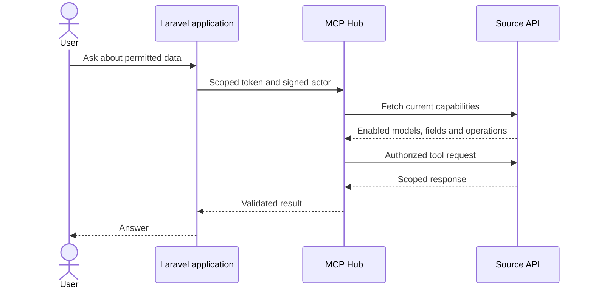

# Laravel adapter

The reusable Composer package proposal is documented in
[Laravel MCP Hub Connector PRD](package/PRD.md). It covers compatibility with legacy
and modern Laravel applications, automated onboarding, and migration from this overlay.

## Composer package pilot

The development [public-package migration guide](PUBLIC_PACKAGE_MIGRATION.md)
records the isolated migration, preservation checks and recovery process. It does
not change the installed application until an explicit target migration is run.

Public release: [ardanayatraa/laravel-mcp-hub on Packagist](https://packagist.org/packages/ardanayatraa/laravel-mcp-hub),
[source repository](https://github.com/ardanayatraa/laravel-mcp-hub), MIT,
version v0.2.0-alpha.1. The standalone checkout lives in repositories/laravel-mcp-hub
under the Hub workspace and has a separate Git history.

The generic [package alpha](package/README.md) has an empty default model list.
The working [Laravel 12 sandbox](sandbox-modern/SANDBOX.md) is available locally at
http://127.0.0.1:18120 with dummy users and orders.

The local HiReach installation uses the package's Hub transport and its existing
application-owned registry, source routes, actor checks and permissions. Run
**.\integrations\laravel\dev-hireach.ps1** from the repository root to start the
configured local Hub and HiReach runtime when their ports are free. HiReach runs
at http://127.0.0.1:18881 because the separate Laragon web runtime currently uses
PHP 7.4, while the application's installed dependencies need PHP 8.1 or later.
The dedicated runtime uses the available PHP 8.3 CLI.

The pilot verified 83 MCP tests and 69 AI integration tests in isolated SQLite
databases, plus live source health and a matching Hub catalog of 4 models and
11 read tools. Live catalog verification does not read business records.
The generic package sandbox passed 14 connector tests and one real HTTP transport
test against the local Postman simulation.

The public 0.2 alpha retains Laravel 5.8 through 13 support in one package, with
PHP 7.2.5 as the package minimum and effective PHP requirements following the
framework. All 13 PHP/framework CI combinations passed. The local pilot above
still uses its earlier path dependency; this compatibility release does not
change application dependencies.

The unreleased `feature/stable-1.0` branch now implements one-use pairing/recovery,
durable replay protection, authenticated CRUD proposals, protected settings/chat,
and private queued CSV/XLSX/PDF exports. Its final public-package CI passed all
13 compatibility combinations (116 tests each, two opt-in skips), plus separate
native PostgreSQL and chat asset jobs. See [PR #2](https://github.com/ardanayatraa/laravel-mcp-hub/pull/2)
and [the release evidence](../../docs/STABLE_RELEASE.md).

An additional code-only copy of HiReach adopted the public development package
and passed 85 native connector tests and 11 client tests. Its environment and
connector configuration hashes were preserved. The original application was not
changed by that cutover test. Review the host's dependency advisories and its
vendor customization before applying the migration to the real installation.

The connected application owns model registrations, fields and permissions. MCP Hub
discovers its approved tools through the source API. Registering a model requires no
per-model Hub code or custom Artisan command.

The `overlay/` directory contains reviewed files from the connected Laravel application,
including its existing chat and settings components. Installation is guarded by source
hashes; this snapshot must be reviewed before applying it to a different application.

Write tools (prepare create, update, delete) take the model's fillable, registered fields.
One-time and account codes such as `otp`, `pin` and `cvv` are excluded from both readable
fields and write inputs. An existing registration containing one of these fields must be
cleaned before the Hub can publish its tools.

## Connection

Laravel reads its connection settings from `.env` through `config/ai.php`. **Apps → Connect app**
in the Hub prints them as one block to paste (app key `hireach`, base URL = `APP_URL`):

- `MCP_HUB_URL`, `MCP_HUB_CLIENT_KEY`: the Hub's MCP address and the app's client key
- `MCP_HUB_BASE_URL`, `MCP_HUB_APP_TOKEN`, `MCP_HUB_DELEGATION_SECRET`: how the Hub reaches this app

The older names (`MCP_HUB_ENABLED`, `MCP_HUB_TOKEN`, `MCP_HUB_SOURCE_URL`, `MCP_HUB_SOURCE_KEY`)
still work; when both are set, the names above win.

`MCP_BRIDGE_*` configures where AI models come from. Left out, the adapter uses the Hub's model
gateway next to `MCP_HUB_URL` with the same client key, so models and their keys are managed under
**AI providers** in the Hub. Set both only to use another bridge:

- `MCP_BRIDGE_URL=https://<bridge>/mcp`
- `MCP_BRIDGE_TOKEN=<its token>`

The app's **Chat** must be on in the Hub. HiReach's model picker then lists the Hub models the app
may use (`provider/model` ids; narrow them under **Model gateway access** on the app's Chat tab) and
its chat calls them through the Hub; data tools still go through `MCP_HUB_URL`. A model outside that
list is refused (`MODEL_NOT_ALLOWED`), and once the app's monthly token budget is used up calls get
`BUDGET_EXCEEDED` until an admin raises it. In production the Hub must be served over HTTPS.

The local connection and credentials are stored in ignored
`.verification/laravel-connection.json`. Its `source_path` identifies the installed
Laravel application. Maintenance scripts also accept `LARAVEL_APP_PATH`; new local
configuration can set `LARAVEL_SOURCE_URL`. No application directory or tool prefix is
hardcoded in the Hub connection helpers. Existing tokens and connection URLs are reused.

The local Hub uses `.verification/hub-uat.db` and the existing encryption key. Its
launcher is `.verification/start-hub.ps1`; start it only when port 18000 is free.
Use the source URL saved in the connection state for callbacks. Do not publish the
private state, launcher, backups or application `.env`.

## Models and permissions

Open `/admin/settings/ai` and use **Add Model** or **Edit** to configure a registration:
model, display name, resource key, user ownership column, readable fields, optional
lookup field, and exact-match filters for selected text fields. Enter up to 50 distinct
filter values per field, separated by commas. List and count tools accept only those
values. Models are discovered from `app/Models`. Schema discovery reads metadata;
hidden, credential, personal and unsupported fields cannot be exposed to AI.

New AI settings default to On; a saved Off state remains Off. **Enable AI** uses an
On/Off switch and saves immediately. The user AI menu follows the saved status.
Model permissions use checkboxes and save immediately, patching only the changed flag.
Readable fields in the modal save with **Save Model**. Removal uses a confirmation modal
and removes the registration without changing business records.

The registration list starts empty. A model appears in MCP only when both **Enabled**
and **Read** are granted. Scope is **Current User**, using the registered numeric owner
column. Team or organization ownership requires an explicit scope adapter.

Model registrations are stored in `ai_integrations.permissions`; there are no configured
fallback models. `config/ai.php` contains connection settings, global CRUD flags and
optional validation rules. Create, Update and Delete default to Off. When enabled,
writable fields and basic validation follow fillable attributes and the table schema.
Migration `2026_10_20_000001_enable_blast_message_status_filter.php` adds `SUCCESS` and
`FAILED` to an existing Blast Messages registration only when its readable `status`
field has no filter values. It preserves all existing access flags and administrator
filter choices.
Migration `2026_10_20_000002_harden_ai_detail_access.php` removes sensitive code fields
from the latest registration and adds exact-name lookup to Blast Messages (`title`) and
Billing Users (`name`) when those readable fields are selected. It preserves existing
access flags and lookup choices. Run both migrations when upgrading an existing HiReach
installation; new registrations are validated by the same field policy.

The source manifest supplies the application key and stable tool identifiers such as
`your_app.projects.list`, exposed through MCP as `your_app__projects__list`.
List/count tools are generated for registered models; a lookup field adds a get tool for
current-user detail by exact registered value. Chat requests for a named record include
that lookup argument, and malformed model tool calls receive a retryable validation error.
Field schemas follow the model's registered fields. No separate Hub model setup is needed.

The source-managed connector refreshes grants on MCP list/call. Open Hub catalog pages
also refresh every 10 seconds while visible and when returning to the tab. Empty grants,
global Off, or an invalid policy response deny access. Chat answers about available data
use the current permitted registrations and tools, without reading business records.
Requests naming an unavailable model are rejected before AI completion or data calls;
the chat cannot substitute another model, even after an incorrect earlier reply.

CRUD tools prepare an actor-bound, expiring proposal. The user confirms in the source
application, which rechecks permissions, ownership, schema and record state before
committing. MCP does not expose a commit tool. Native exports use the same registered
fields and authenticated application download workflow.

PDF and Excel reports include a **Lihat preview** link that opens a simple report page
in a new tab. The page shows the HiReach logo, report metadata and all exported rows,
with **Unduh** and **Cetak / Simpan PDF** actions. Preview and download URLs use the
same account-bound, two-hour token; generated files are pruned after three hours.
Preview and download links also stop working if the account's model permission,
readable fields, approved filters or ownership scope changes after generation.
Links also close if any included record leaves the account's scope or no longer
matches the report's status filter. Reports generated before this record check
must be generated again.
Status-filtered Blast Messages reports require that exact status to be allowed by
the administrator. Report requests naming Billing Users or another registered model
use that model, including the chat fallback path.
Reports created before this access-signature check must be generated again after upgrade.
PDF creation and preview use application code and the browser's built-in print feature,
without adding a Composer or JavaScript package. Exports reject more than 1,000 rows
or 2 MB of report text with a clear error instead of silently truncating data. When PDF text contains characters
outside the built-in PDF font, the report opens as a Unicode-safe browser preview and
offers **Cetak / Simpan PDF** instead of a damaged direct PDF download. While a request runs, chat
shows whether it is preparing a report or composing a response.
Reports support PDF and Excel. CSV requests receive a clear unsupported-format reply.
The chat applies a Blast Messages status filter only when the user's current request
explicitly names that status, so a model cannot silently narrow an all-status report.
Report queries select only the registered readable columns and the record ID.
The chat offers tools for the current request only. A result containing instructions
cannot trigger an unrequested export, write proposal or read of another named model;
the server checks every requested tool against the offered set. In chat, only issued
report links owned by the current account remain clickable. Other model-generated
links are displayed as text.

## Adapter files

| File | Responsibility |
|---|---|
| `app/Services/Mcp/McpClient.php` | Shared HTTP transport for both MCP connections |
| `app/Services/Mcp/McpHubClient.php` | Scoped tool discovery and calls |
| `app/Services/Mcp/McpResourceRegistry.php` | Registrations, schemas and capabilities |
| `app/Services/Mcp/McpActorIdentity.php` | Signed actor and current-account verification |
| `app/Services/Mcp/McpPrivacyGuard.php` | Prompt privacy checks |
| `app/Http/Controllers/McpConnectorController.php` | Authenticated reads and CRUD proposals |
| `config/ai.php` | AI/MCP settings, CRUD switches and validation overrides |
| `routes/api.php` | Source endpoints and authenticated confirmation route |

Existing AI services, chat, settings, navigation and tests remain in their native Laravel
directories. `Table/AiAccessTable.php` uses Mediconesystems Livewire Datatables for
search, sorting, pagination and immediate permission updates.

## Maintenance scripts

- `prepare.py`: validates an unmodified application against `source-baselines.json`.
- `install.py`: dry-run by default; `--apply` checks originals, backs up files and installs
  the reviewed overlay. Use `sync.py` for an already installed adapter.
- `sync.py`: verifies installed hashes, preserves original backups and applies reviewed
  follow-ups. `--check` verifies the installed files without writing changes.
- `configure.py`: reuses local credentials and updates only adapter environment keys.
- `provision.py`: connects the source-managed application, discovers permitted tools and
  reuses its scoped key. Requires `HUB_ADMIN_PASSWORD` and optionally `HUB_ADMIN_EMAIL`.
- `verify.py`: checks source authentication and compares the current read-only catalog
  with source permissions. It does not read business records or change access grants.

## Upgrading the Hub to 0.2

Back up the local database before migration. Run `alembic upgrade head` from `backend`
using the same database URL and encryption key as the local launcher. The Hub refuses
to start on the old schema. The source-managed catalog follows current application grants.

## Verification

The Laravel MCP connector suite passed 83 tests and the AI integration suite passed 67 tests
using the local test database. The Hub suite passed 252 tests using isolated databases and mocked
requests. Frontend type checking and production builds passed. The live browser audit also
depends on a reachable configured model provider.

`docs/evidence/LARAVEL_CRUD_CONTRACT.json` is a Laravel-generated dummy contract with a
neutral application key, used by the Hub regression tests. Its private generator is
`.verification/export-laravel-crud-contract.php`.

- [Integration verification report](../../docs/evidence/LARAVEL_INTEGRATION_EVIDENCE.json)

From the repository root, run
`backend/.venv/Scripts/python.exe integrations/laravel/verify.py` to verify the existing
read-only catalog. Credentials and access permissions are preserved.
