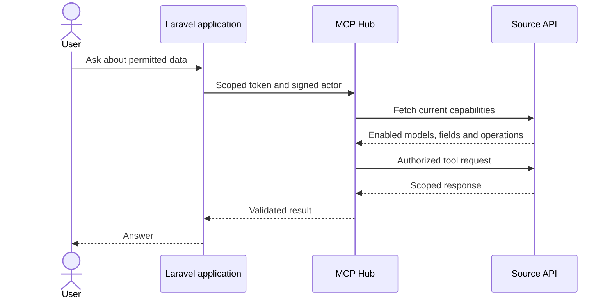

# Laravel adapter

The connected application owns model registrations, fields and permissions. MCP Hub
discovers its approved tools through the source API. Registering a model requires no
per-model Hub code or custom Artisan command.

The `overlay/` directory contains reviewed files from the connected Laravel application,
including its existing chat and settings components. Installation is guarded by source
hashes; this snapshot must be reviewed before applying it to a different application.

Write tools (prepare create, update, delete) take the model's fillable, registered fields,
except one-time and account codes such as `otp`, `pin` or `cvv`: MCP Hub refuses those as
write inputs, and one refused input would hide every tool of the app.

## Connection

Laravel reads its connection settings from `.env` through `config/ai.php`:

- `MCP_HUB_ENABLED`, `MCP_HUB_URL`, `MCP_HUB_TOKEN`
- `MCP_HUB_SOURCE_URL`, `MCP_HUB_SOURCE_KEY`, `MCP_HUB_DELEGATION_SECRET`

Existing `MCP_BRIDGE_*` settings continue to configure the AI provider bridge. The Hub
handles data tools; the provider bridge handles AI model discovery and chat.

The local connection and credentials are stored in ignored
`.verification/laravel-connection.json`. Its `source_path` identifies the installed
Laravel application. Maintenance scripts also accept `LARAVEL_APP_PATH`; new local
configuration can set `LARAVEL_SOURCE_URL`. No application directory or tool prefix is
hardcoded in the Hub connection helpers. Existing tokens and connection URLs are reused.

The local Hub uses `.verification/hub-uat.db` and the existing encryption key. Its
launcher is `.verification/start-hub.ps1`; start it only when port 18000 is free.
Use the source URL saved in the connection state for callbacks. Do not publish the
private state, launcher, backups or application `.env`.

## Models and permissions

Open `/admin/settings/ai` and use **Add Model** or **Edit** to configure a registration:
model, display name, resource key, user ownership column, readable fields and optional
lookup field. Models are discovered from `app/Models`. Schema discovery reads metadata;
hidden, credential, personal and unsupported fields cannot be exposed to AI.

New AI settings default to On; a saved Off state remains Off. **Enable AI** uses an
On/Off switch and saves immediately. The user AI menu follows the saved status.
Model permissions use checkboxes and save immediately, patching only the changed flag.
Readable fields in the modal save with **Save Model**. Removal uses a confirmation modal
and removes the registration without changing business records.

The registration list starts empty. A model appears in MCP only when both **Enabled**
and **Read** are granted. Scope is **Current User**, using the registered numeric owner
column. Team or organization ownership requires an explicit scope adapter.

Model registrations are stored in `ai_integrations.permissions`; there are no configured
fallback models. `config/ai.php` contains connection settings, global CRUD flags and
optional validation rules. Create, Update and Delete default to Off. When enabled,
writable fields and basic validation follow fillable attributes and the table schema.

The source manifest supplies the application key and stable tool identifiers such as
`your_app.projects.list`, exposed through MCP as `your_app__projects__list`.
List/count tools are generated for registered models; a lookup field adds a get tool.
Field schemas follow the model's registered fields. No separate Hub model setup is needed.

The source-managed connector refreshes grants on MCP list/call. Open Hub catalog pages
also refresh every 10 seconds while visible and when returning to the tab. Empty grants,
global Off, or an invalid policy response deny access. Chat answers about available data
use the current permitted registrations and tools, without reading business records.
Requests naming an unavailable model are rejected before AI completion or data calls;
the chat cannot substitute another model, even after an incorrect earlier reply.

CRUD tools prepare an actor-bound, expiring proposal. The user confirms in the source
application, which rechecks permissions, ownership, schema and record state before
committing. MCP does not expose a commit tool. Native exports use the same registered
fields and authenticated application download workflow.

## Adapter files

| File | Responsibility |
|---|---|
| `app/Services/Mcp/McpClient.php` | Shared HTTP transport for both MCP connections |
| `app/Services/Mcp/McpHubClient.php` | Scoped tool discovery and calls |
| `app/Services/Mcp/McpResourceRegistry.php` | Registrations, schemas and capabilities |
| `app/Services/Mcp/McpActorIdentity.php` | Signed actor and current-account verification |
| `app/Services/Mcp/McpPrivacyGuard.php` | Prompt privacy checks |
| `app/Http/Controllers/McpConnectorController.php` | Authenticated reads and CRUD proposals |
| `config/ai.php` | AI/MCP settings, CRUD switches and validation overrides |
| `routes/api.php` | Source endpoints and authenticated confirmation route |

Existing AI services, chat, settings, navigation and tests remain in their native Laravel
directories. `Table/AiAccessTable.php` uses Mediconesystems Livewire Datatables for
search, sorting, pagination and immediate permission updates.

## Maintenance scripts

- `prepare.py`: validates an unmodified application against `source-baselines.json`.
- `install.py`: dry-run by default; `--apply` checks originals, backs up files and installs
  the reviewed overlay. Use `sync.py` for an already installed adapter.
- `sync.py`: verifies installed hashes, preserves original backups and applies reviewed
  follow-ups. `--check` verifies the installed files without writing changes.
- `configure.py`: reuses local credentials and updates only adapter environment keys.
- `provision.py`: connects the source-managed application, discovers permitted tools and
  reuses its scoped key. Requires `HUB_ADMIN_PASSWORD` and optionally `HUB_ADMIN_EMAIL`.
- `verify.py`: checks source authentication and compares the current read-only catalog
  with source permissions. It does not read business records or change access grants.

## Upgrading the Hub to 0.2

Back up the local database before migration. Run `alembic upgrade head` from `backend`
using the same database URL and encryption key as the local launcher. The Hub refuses
to start on the old schema. The source-managed catalog follows current application grants.

## Verification

The Laravel suite passed 83 tests / 943 assertions using in-memory SQLite. The Hub suite
passed 153 tests using isolated databases and mocked requests. Frontend type checking
and production builds passed.

`docs/evidence/LARAVEL_CRUD_CONTRACT.json` is a Laravel-generated dummy contract with a
neutral application key, used by the Hub regression tests. Its private generator is
`.verification/export-laravel-crud-contract.php`.

- [Integration verification report](../../docs/evidence/LARAVEL_INTEGRATION_EVIDENCE.json)

From the repository root, run
`backend/.venv/Scripts/python.exe integrations/laravel/verify.py` to verify the existing
read-only catalog. Credentials and access permissions are preserved.
